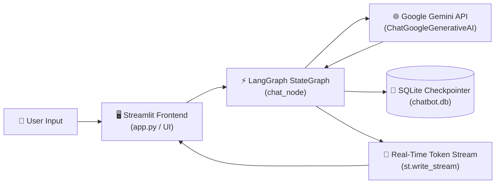

# 🤖 LangGraph Gemini AI Chatbot

[](https://www.python.org/)
[](https://github.com/langchain-ai/langgraph)
[](https://streamlit.io/)
[](https://ai.google.dev/)
[](https://sqlite.org/)
[](LICENSE)

A modern, full-featured AI Chatbot built with **LangGraph**, **Google Gemini**, and **Streamlit**. It features persistent multi-turn conversational memory powered by SQLite checkpointers, real-time token streaming, customizable AI personas, and comprehensive conversation management (search, rename, export, and delete).

---

## 📑 Table of Contents

- [✨ Key Features](#-key-features)
- [🏗️ Architecture & How It Works](#️-architecture--how-it-works)
- [📁 Project Structure](#-project-structure)
- [⚙️ Prerequisites](#️-prerequisites)
- [🚀 Quickstart Installation](#-quickstart-installation)
  - [1. Clone Repository](#1-clone-the-repository)
  - [2. Set Up Virtual Environment](#2-set-up-virtual-environment)
  - [3. Install Dependencies](#3-install-dependencies)
  - [4. Set Up Environment Variables](#4-configure-environment-variables)
  - [5. Run the Application](#5-run-the-application)
- [💡 Usage Guide](#-usage-guide)
  - [Conversation Management](#conversation-management)
  - [Switching Models & Personas](#switching-models--personas)
  - [Exporting Chats](#exporting-chats)
- [🔧 Configuration & Customization](#-configuration--customization)
- [❓ Troubleshooting & FAQ](#-troubleshooting--faq)
- [📜 License](#-license)

---

## ✨ Key Features

- **🧠 Persistent Multi-Turn Memory**: Uses LangGraph's `SqliteSaver` checkpointer to preserve every conversation thread across page reloads, browser tabs, and app restarts.
- **⚡ Google Gemini Integration**: Dynamically switch between:
  - `gemini-3.8-flash` *(Recommended Flagship — fast, highly intelligent)*
  - `gemini-3.5-flash-lite` *(Ultra-fast and lightweight)*
  - `gemini-3.1-pro-preview` *(Deep reasoning for complex tasks)*
- **🎭 Customizable AI Personas**:
  - 🤖 **General Assistant** — Well-rounded, helpful, and respectful
  - 👨‍💻 **Senior Software Engineer** — Clean code, architecture, and code review
  - 🎓 **Patient Teacher & Tutor** — Step-by-step intuitive analogies
  - 📝 **Concise & Fluff-Free** — Bullet-pointed, high-density answers
  - 🧠 **Creative Brainstormer** — Out-of-the-box ideas and ideation
  - ✏️ **Custom System Instructions** — Write your own system prompt at runtime
- **💬 Full Conversation Lifecycle Management**:
  - **Auto-generated Titles**: Conversations are automatically named based on the first prompt.
  - **Inline Renaming**: Change chat titles on the fly with a single click.
  - **Real-Time Search**: Filter and search through past conversations by keyword.
  - **Clean New Chats**: Empty chats don't pollute the sidebar until a message is sent.
  - **Safe Deletion**: Delete individual chats or clear all chat history with confirmation.
- **📥 Chat Export**: One-click download of conversation history in:
  - **Markdown (`.md`)** — Nicely formatted headings and code blocks.
  - **JSON (`.json`)** — Structured metadata, timestamps, and message payloads.
- **🌊 Real-Time Token Streaming**: Low-latency token-by-token streaming via `st.write_stream`.
- **💡 Starter Prompt Cards**: Interactive cards on new conversations for instant prompt inspiration.

---

## 🏗️ Architecture & How It Works

The chatbot uses a stateful computational graph orchestrated by **LangGraph**:



1. **State Isolation**: Every user chat session is assigned a unique `thread_id` (UUID).
2. **LangGraph StateGraph**: Maintains a message state `messages: Annotated[list[BaseMessage], add_messages]`.
3. **Dynamic Node Configuration**: When invoking the graph, `RunnableConfig` dynamically supplies:
   - `model_name`
   - `temperature`
   - `system_prompt`
   - `api_key` override (if provided)
4. **SQLite Persistence**:
   - `checkpoints` & `writes` tables record state snapshots.
   - `thread_metadata` table indexes titles, timestamps, and models for fast queries and search.

---

## 📁 Project Structure

```text
AIChatbot/
├── app.py                         # Unified entry point (`streamlit run app.py`)
├── streamlit_frontend_database.py # Primary Streamlit UI with conversation management
├── langgraph_database_backend.py  # LangGraph graph, SQLite checkpointer, and DB logic
├── requirements.txt               # Project Python package dependencies
├── .env.example                   # Template for environment variables
├── .env                           # Local environment variables (API keys - Git ignored)
├── .gitignore                     # Git ignore rules for secrets, DBs, and venv
├── chatbot.db                     # SQLite database (auto-generated at runtime)
└── README.md                      # Project documentation
```

---

## ⚙️ Prerequisites

- **Python 3.10+** installed on your system.
- A **Google Gemini API Key** (obtainable free from [Google AI Studio](https://aistudio.google.com/)).

---

## 🚀 Quickstart Installation

### 1. Clone the Repository

```bash
git clone https://github.com/your-username/AIChatbot.git
cd AIChatbot
```

### 2. Set Up Virtual Environment

Create and activate an isolated virtual environment:

#### On macOS / Linux:
```bash
python3 -m venv myenv
source myenv/bin/activate
```

#### On Windows (PowerShell):
```powershell
python -m venv myenv
.\myenv\Scripts\Activate.ps1
```

#### On Windows (Command Prompt):
```cmd
python -m venv myenv
myenv\Scripts\activate.bat
```

### 3. Install Dependencies

Install all required packages from `requirements.txt`:

```bash
pip install --upgrade pip
pip install -r requirements.txt
```

### 4. Configure Environment Variables

Copy the example environment file and add your Google Gemini API key:

```bash
cp .env.example .env
```

Open `.env` in any text editor and add your key:

```env
GOOGLE_API_KEY="your_actual_gemini_api_key_here"
```

> **Security Note:** `.env` and `chatbot.db` are already included in `.gitignore` so your private API keys and conversations are never pushed to GitHub.

### 5. Run the Application

Start the Streamlit application:

```bash
streamlit run app.py
```

The application will launch automatically in your default browser at:
```
http://localhost:8501
```

*(You can also run directly with `streamlit run streamlit_frontend_database.py`)*

---

## 💡 Usage Guide

### Conversation Management
- **Start New Chat**: Click the `➕ New Chat` button at the top of the sidebar.
- **Switch Chats**: Click any conversation in the sidebar list. The active chat is highlighted with a `👉` marker.
- **Search Chats**: Type keywords into the `🔍 Search chats` input box to instantly filter conversation titles.
- **Rename Chat**: In the chat top bar, click the `✏️` icon, type a new title, and click **Save**.
- **Delete Chat**: In the chat top bar, click the `🗑️` icon and confirm deletion.
- **Clear Everything**: Open the `🗑️ Clear All Chats` dropdown in the sidebar to reset the entire database.

### Switching Models & Personas
Expand **⚙️ Model & Persona Settings** in the sidebar:
- Choose from `gemini-3.8-flash`, `gemini-3.5-flash-lite`, or `gemini-3.1-pro-preview`.
- Pick a persona from the dropdown or select **Custom Instructions** to inject custom system prompts.
- Adjust the **Creativity (Temperature)** slider to control randomness.

### Exporting Chats
In the chat top bar, click the `📥` icon to export your current conversation:
- Click **Download Markdown** to save a `.md` notes file.
- Click **Download JSON** to save structured conversation logs.

---

## 🔧 Configuration & Customization

### Adding New Personas
To add your own preset personas, open [`streamlit_frontend_database.py`](streamlit_frontend_database.py) and add entries to the `PERSONAS` dictionary:

```python
PERSONAS = {
    "🤖 General Assistant": "You are a helpful, respectful, and honest AI assistant...",
    "📈 Data Analyst": "You are an expert data analyst specializing in Python, Pandas, and SQL...",
    # Add your custom presets here
}
```

### Customizing the Database Path
By default, conversation state is saved to `chatbot.db` in the project root. You can modify `DB_PATH` in [`langgraph_database_backend.py`](langgraph_database_backend.py):

```python
DB_PATH = "custom_path/chatbot.db"
```

---

## ❓ Troubleshooting & FAQ

<details>
<summary><strong>1. Error: "google_api_key must be provided" or 400 INVALID_ARGUMENT</strong></summary>

- Ensure your `.env` file exists in the project root and contains:
  ```env
  GOOGLE_API_KEY="your-key-here"
  ```
- Alternatively, you can enter your API key directly into the **API Key Override** field in the sidebar settings.
- Verify your key is active on [Google AI Studio](https://aistudio.google.com/).
</details>

<details>
<summary><strong>2. Error: 404 NOT_FOUND for a Gemini model</strong></summary>

- Older models (such as `gemini-2.5-flash`) have been deprecated. This project uses the modern `gemini-3.8-flash`, `gemini-3.5-flash-lite`, and `gemini-3.1-pro-preview` models.
- Select `gemini-3.8-flash` in the sidebar settings.
</details>

<details>
<summary><strong>3. Port 8501 is already in use</strong></summary>

If port 8501 is occupied by another process, run Streamlit on a different port:
```bash
streamlit run app.py --server.port 8502
```
</details>

<details>
<summary><strong>4. Database is locked (sqlite3.OperationalError: database is locked)</strong></summary>

- SQLite handles concurrent reads easily, but if multiple processes write simultaneously or a stale process holds a lock:
  1. Close any running Streamlit instances.
  2. Restart the app using `streamlit run app.py`.
</details>

---

## 📜 License

This project is licensed under the [MIT License](LICENSE) — free for personal and commercial use.

---

⭐ **If you find this project helpful, give it a star on GitHub!**
